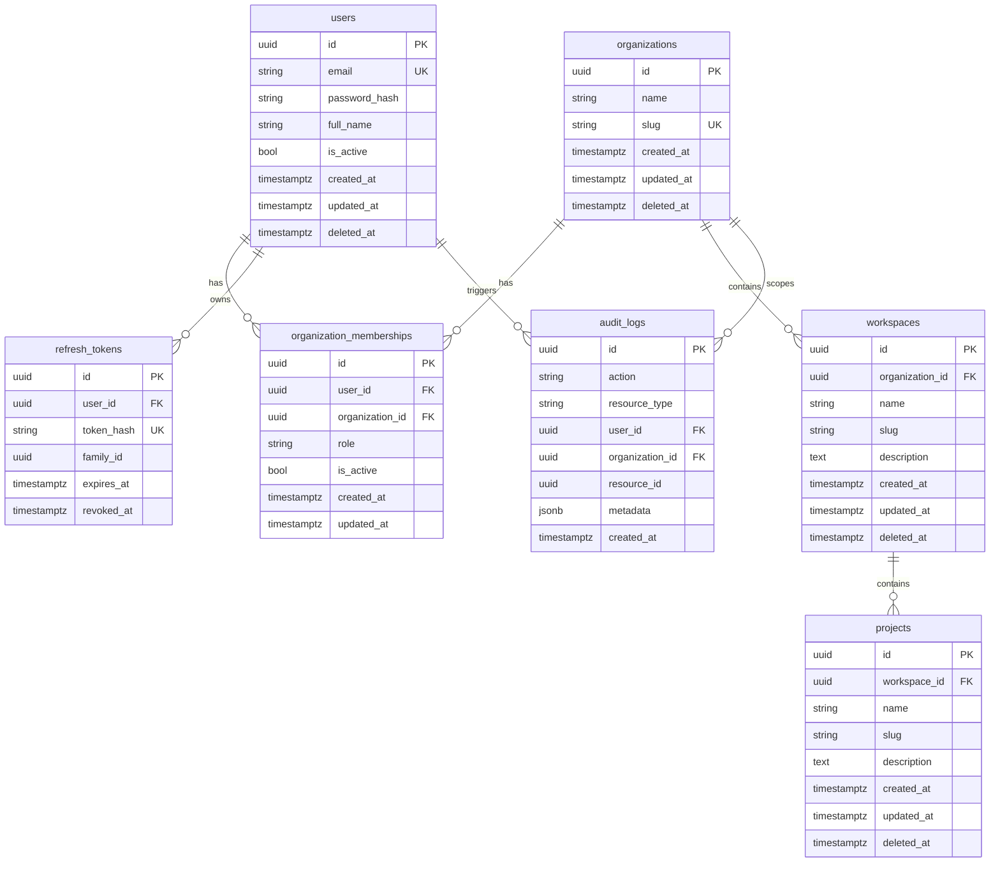
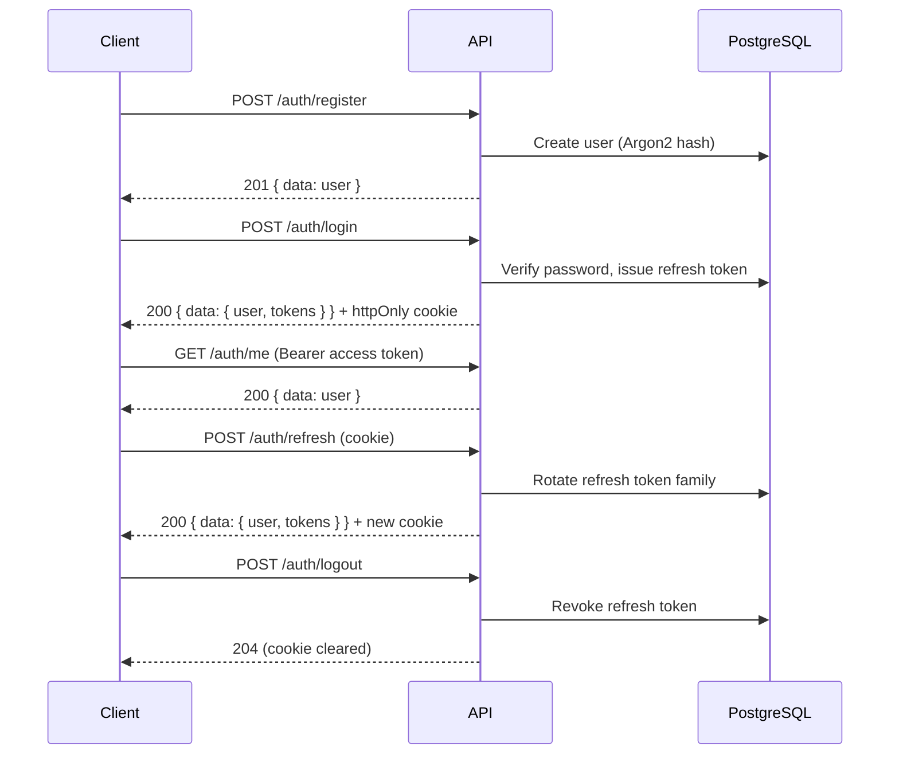

# Identity & Tenancy (Phase 2)

This document covers the domain model, authentication flow, authorization strategy, database
schema, and API surface introduced in Phase 2.

## Entity relationship diagram

## Ownership rules

1. Every workspace belongs to exactly one organization.
2. Every project belongs to exactly one workspace (and therefore one organization).
3. Users access tenant resources only through active memberships.
4. Future datasets, analyses, and reports will attach to **projects** and inherit tenant scope.
5. Soft deletes (`deleted_at`) on users, organizations, workspaces, and projects preserve audit history.

## Database constraints

| Constraint | Rationale |
|------------|-----------|
| `uq_organization_memberships_user_org` | One membership row per user per org |
| `uq_workspaces_org_name` / `uq_workspaces_org_slug` | Unique workspace identity within org |
| `uq_projects_workspace_name` / `uq_projects_workspace_slug` | Unique project identity within workspace |
| `ON DELETE CASCADE` on membership/workspace/project FKs | Tear down child rows when parent is removed |
| `ON DELETE SET NULL` on audit log user/org FKs | Preserve logs after entity deletion |

Migration: `backend/migrations/versions/20250705180000_phase2_identity_tenancy.py`

## Authentication flow

**Token storage (frontend):** access token in `sessionStorage`; refresh token in httpOnly cookie.
The API client automatically retries once on `401` by calling `/auth/refresh`.

## Authorization strategy

RBAC is centralized in `AuthorizationService`. Roles and permissions:

| Role | Create org | Manage members | Workspace CRUD | Project CRUD | Read all |
|------|------------|----------------|----------------|--------------|----------|
| Owner | ✓ | ✓ | ✓ | ✓ | ✓ |
| Admin | — | ✓ | ✓ | ✓ | ✓ |
| Analyst | — | — | read | create/read | ✓ |
| Viewer | — | — | read | read | ✓ |

Tenant-scoped routes require:

1. Valid JWT (`Authorization: Bearer`)
2. Active membership for the org in `X-Organization-ID`

## Developer onboarding checklist

1. Copy `.env.example` → `.env` and set `DELPHI_JWT_SECRET_KEY`.
2. Start infrastructure: `docker compose up -d postgres redis`
3. Run migrations: `cd backend && uv run alembic upgrade head`
4. Start backend: `uv run uvicorn app.main:create_app --factory --reload`
5. Start frontend: `cd frontend && npm run dev`
6. Register at `http://localhost:5173/register`, create an organization, then workspaces/projects.

## Testing

- **Unit:** password hashing, authorization matrix (`tests/unit/`)
- **Integration:** full auth + tenancy flow with in-memory repositories (`tests/integration/test_auth_endpoints.py`)
- **Frontend:** login form render test (`frontend/src/pages/auth/login-page.test.tsx`)

Run all backend tests: `make test` or `cd backend && uv run pytest`
